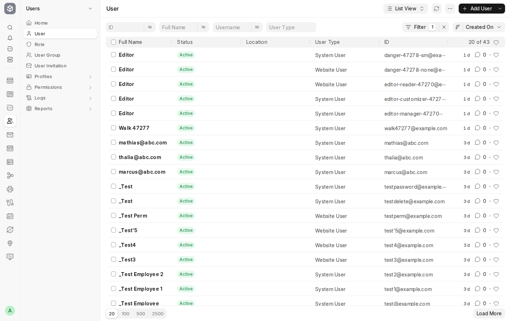
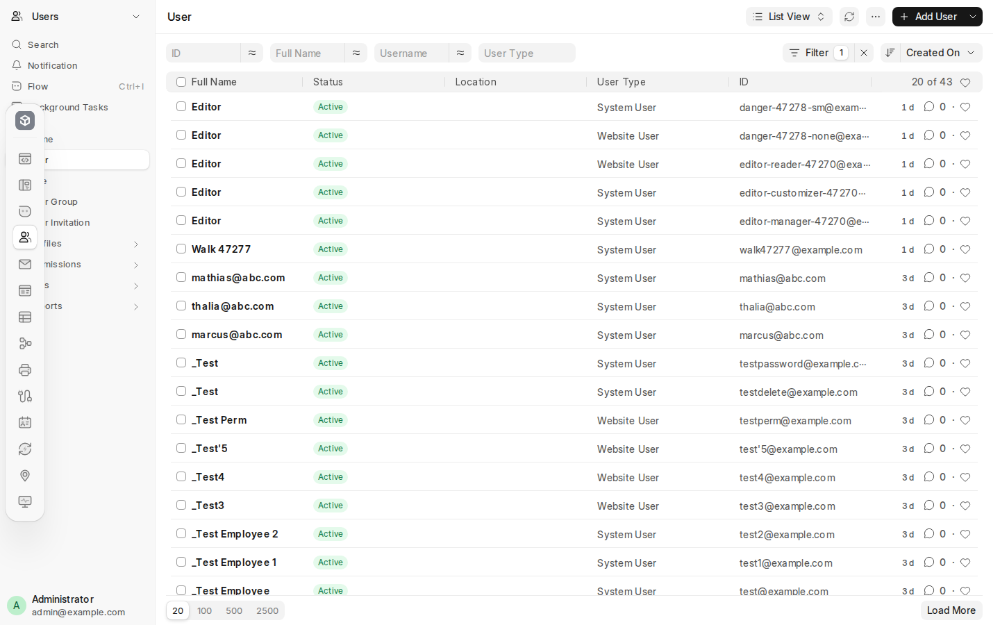
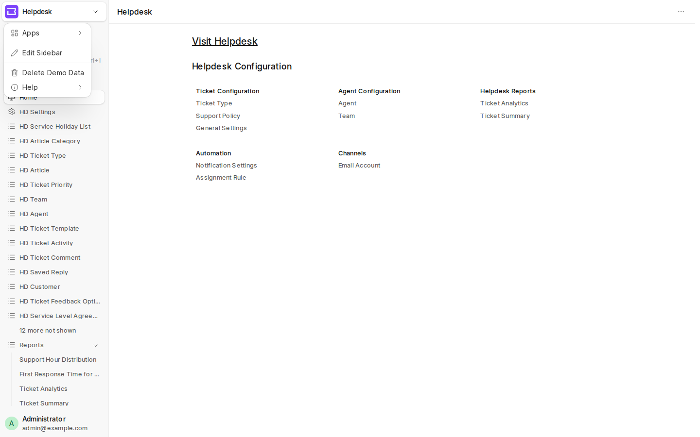

# Desk v1 navigation: the dock, dock-less apps and the utility slot

Research for [#47371](https://github.com/frappe/frappe/issues/47371), part of map
[#47369](https://github.com/frappe/frappe/issues/47369). Facts only, no design recommendation.

**Source.** `frappe/frappe` `develop` at `3fc507a834` (fetched 2026-11-14). Short paths:

- `sidebar/` = `frappe/public/js/frappe/ui/sidebar/`
- `scss/` = `frappe/public/scss/desk/`
- `dock.py` = `frappe/desk/doctype/dock/dock.py`

**Live check.** The measurements and screenshots come from `desk.localhost` `/desk` (v1). Its checkout
is `desk-v2` at `2dbf7bfdff`, and its v1 navigation code is the same as `develop`. The only
difference is one extra "Desk v2" row in the user menu. Setup: Chromium at 1440x900, logged in as
Administrator. Floating mode was switched on in the client only (`dock.set_pinned(false)`), so
nothing was saved.

**A note on "tray".** v1 has no separate tray component. The word is used for the floating dock's
own body ("a floating tray of app-module icons", `scss/dock.scss:1`, and the Settings preview
`.dock-preview-tray`, `user_settings_dialog.js:604-610`). The thing the ticket calls the tray (search,
notifications, Flow, background tasks) is the dock's `.dock-utilities` slot or the sidebar's
`.standard-items-band`. This file calls it the **utility slot**.

---

## 1. Dock modes: pinned and floating

**Two modes, one element.** `#desk-dock` holds the app logo, the utility slot, the tiles and the
avatar (`sidebar/dock.js:22-41`). It is inserted before `.body-sidebar-container` (`dock.js:43-48`).

| | Pinned (default) | Floating |
|---|---|---|
| Body class | `dock-pinned` and `dock-open` (`dock.js:135-142`) | `dock-open` only while revealed (`dock.js:332-336`) |
| Geometry | In-flow column at the left of the sidebar: `position: relative`, full height, `border-right`, no radius or shadow (`scss/dock.scss:280-319`) | `position: fixed; left: 8px; top: 50%`. Parked at `translate(-150%, -50%)`, z-index 1030 (above the sidebar's 1020), radius 18px, `shadow-2xl`, `max-height: calc(100vh - 32px)` (`dock.scss:30-66`, `276-278`) |
| Utility slot | In the dock. The sidebar band hides its four rows at md and up (`dock.scss:351-373`) | Hidden in the dock (`dock.scss:126-128`). The rows stay in the sidebar band |
| Avatar | At the foot of the dock (`dock.scss:321-343`). The sidebar's footer user button is hidden at md and up (`dock.scss:345-349`) | Not in the dock. The sidebar footer keeps it |
| Sidebar header mark | Hidden. The active tile already shows the module icon (`dock.scss:375-383`) | Shown |
| Collapsed sidebar | Hides to 0 width (`sidebar.js:706-715`, `dock.scss:385-414`) | Folds to the 48px rail (`sidebar.js:729-751`) |

**Reveal (floating only).** `dock.js:231-277`.

- A `mousemove` on `document` measures the pointer's distance from the dock's edge of the window.
  In RTL this is measured from the right edge.
- Within `REVEAL_EDGE = 1` px, the dock opens. It stays open while the pointer is within
  `HIDE_BAND = 90` px of the edge, or over the dock, or while focus is inside it. It closes once the
  pointer is farther than 90px (`dock.js:5-7`, `304-309`).
- The code reads the pointer position on purpose instead of using a hover strip or `mouseleave`. The
  reasons are in the comments at `dock.js:236-238`.
- A click outside the dock, Escape, or focus leaving the dock closes it (`dock.js:260-276`). A
  closed dock is `inert` and `aria-hidden` (`dock.js:331-336`).
- `prefers-reduced-motion` turns the slide off (`dock.scss:449-457`).

**Touch.**

- Reveal needs `(any-hover: hover)` (`dock.js:231-234`). A touch-only screen cannot reveal a
  floating dock.
- On a page with `hide_sidebar` and no hover-capable pointer, the dock is pinned whatever the
  preference (`dock.js:127-133`).
- Elsewhere on such a screen the dock stays unreachable. To cover this, the sidebar header gives back
  the full module and app switcher when `!pointer_can_reveal()` (`sidebar_header.js:154-164`).
- Below the `sm` breakpoint the dock is `display: none` (`dock.scss:459-466`). Phones show the dock
  entries as a row of tiles at the top of the navigation bottom sheet (`mobile_nav.js:10-13`,
  `194-195`, `218-230`). Search, Notifications and Profile become phone pages or tabs
  (`mobile_nav.js:3-9`).
- Drag-to-arrange is disabled on mobile (`dock.js:124`).

**Keyboard.**

- `shift+ctrl+/` toggles the dock, only when it is enabled (`dock.js:279-287`). Opening it records
  the opener and focuses the first tile. Closing it returns focus to the opener (`dock.js:289-298`,
  `317-329`).
- `ctrl+/` toggles the sidebar (`sidebar.js:235-239`). The comment at `dock.js:279` says this is why
  the dock uses `shift`.
- Escape closes a floating dock (`dock.js:268-270`). `close()` does nothing while the dock is pinned
  or held open by the editor (`dock.js:317-318`).

**Where the preference lives and who sets it.**

- The preference is the field `User.dock_mode`: a Select with the values `Floating` and `Pinned`,
  default `Pinned`. Its description is "Pinned sits beside the sidebar. Floating slides in from the
  left edge." (`frappe/core/doctype/user/user.json:810-817`).
- It is one of the `desk_properties` (`frappe/core/doctype/user/user.py:66`). It reaches the client
  as `frappe.boot.desk_settings.dock_mode`, read from the User record only, with no role layer
  (`frappe/boot.py:583-586`).
- The user sets it in **Settings > Appearance > Dock**. This is two preview cards, "Keep the app dock
  beside the sidebar, or let it slide in from the left edge." (`user_settings_dialog.js:510-518`). A
  pick saves the field at once and calls `dock.set_pinned()`, so the dock moves behind the dialog
  (`user_settings_dialog.js:565-597`).
- Because it is a plain User field, anyone who can write the User record can also set it. A test
  does this with `set_value` (`frappe/core/doctype/user/test_user.py:118-122`).
- There is no site-wide setting and no per-app setting.
- The sidebar's own collapsed state is separate. It is kept per browser in `localStorage`
  `desk-sidebar-collapsed` (`sidebar.js:556-572`).

**Page and app gates.**

- `dock.enabled = dock_enabled() && page_allows_dock()` (`dock.js:338-343`).
- A page can set `hide_dock` (`sidebar.js:326-329`) or `hide_sidebar` (`sidebar.js:315-319`)
  independently.

## 2. Dock-less (sidebar-only) apps

**What decides it.** The dock is drawn only if the shown sidebar's app has at least one rail entry:
`dock_enabled() = collect_dock_entries(get_sidebar_app()).length > 0` (`sidebar.js:287-290`).

- The app is the one the shown sidebar belongs to (`Sidebar.app`), mapped to the companion's host
  where one applies. It is not taken from the route (`sidebar.js:253-263`). A module in no app has
  no dock.
- The entries are `app_data[].dock`, which is `get_app_entry_set(app)` (`frappe/boot.py:369`). That
  is the rows of the app's **standard `Dock` record**, plus the rows of any companion mounted on it,
  filtered by what the user can reach (`dock.py:729-807`).
- The standard record ships as `<app>/dock/<app>/<app>.json` (the `Dock.standard` field description
  in `dock.json`, for example `frappe/dock/frappe/frappe.json`). An app that ships no record has no
  base entries. On `desk.localhost` only `frappe` and `erpnext` ship one, so crm, helpdesk, gameplan,
  whatsapp and telephony are dock-less.
- Entries that every layer hides are dropped on the client (`sidebar.js:1049-1057`). An app whose
  entries are all hidden or out of reach is therefore dock-less for that user.
- **Companion apps** (`Dock.mount_on`) never get a rail of their own. Their rows are appended to the
  host's rail, and their workspaces show the host's rail (`dock.py:630-673`, `773-797`;
  `frappe/boot.py:226-242`, `271`). A mount fails, and the companion becomes an ordinary app with its
  own rail, when any of these is true: the host is not installed, the host ships no dock, or the
  companion ships no rows (`dock.py:636-644`).
- There is no "rail of one" rule in code. `sidebar_header.js:169-170` says "the rail's own refusal
  to draw a rail of one", but `dock_enabled()` only checks `> 0`.

**What moves where on a dock-less app.**

| Item | Docked app | Dock-less app |
|---|---|---|
| App switcher | The dock's logo button goes to `/desk` "All apps" (`dock.js:26-33`, `377`). The header menu keeps only "All apps" (`sidebar_header.js:162-164`) | Sidebar header menu: **Apps >** (every app on the apps screen, then All apps) and **Modules >** (only when the app has more than one navigable module) (`sidebar_header.js:152-224`) |
| Logo | App logo at the top of the dock (`dock.js:372-391`). The header shows the **module** icon (`sidebar_header.js:390-394`) | The header shows the **app** logo, and its title still names the module (`sidebar_header.js:361-394`) |
| Search, notifications, Flow, background tasks | Pinned: in the dock's utility slot. Floating: in the sidebar band | Sidebar band, directly under the header (`sidebar.html:3-8`, `sidebar.js:603-652`) |
| Avatar and user menu | Pinned: at the foot of the dock. Floating: sidebar footer | Sidebar footer (`sidebar.html:14-40`) |
| Edit Sidebar | Header menu (`sidebar_header.js:62-77`) | Same |
| Manage Dock | User menu (`sidebar.js:438-447`) | Also offered, because the condition is only "has an app and is not mobile" (`sidebar.js:443-445`) |

Navbar Settings rows and Help also sit in the header menu in both cases (`sidebar_header.js:96-146`).

## 3. The utility slot ("tray")

**What it holds.** The same four items are on both surfaces:

| Item | Shown when | Opens |
|---|---|---|
| Search | `desk_settings.search_bar` | Search modal, through the class `navbar-modal-search-mobile` |
| Notifications | `desk_settings.notifications`. The dock shows an unread dot | `sidebar_panels.toggle("notifications")` |
| Flow | `can_read("Flow Session")`. The sidebar row shows `ctrl+i` | `window.flow.toggle()` |
| Background Tasks | Only while tasks exist | `sidebar_panels.toggle("background-tasks")` |

Sources: the dock in `dock.js:170-229`, the sidebar band in `sidebar.js:603-652`. `search_bar` and
`notifications` are the User fields "Show search bar" and "Allow notifications"
(`user_settings_dialog.js:184-196`). One panel serves both bells, through a shared trigger class
(`sidebar_panel.js:13-16`).

**Where it sits.**

- **Pinned dock:** a column of 28px buttons under the logo band. It is ruled off above the tiles
  (`dock.scss:136-171`). The sidebar band's four rows are hidden by CSS at md and up
  (`dock.scss:351-373`).
- **Floating dock:** hidden in the dock. It stays as full-width rows in the sidebar band under the
  header. The comment gives the reason: a floating dock is off screen until reached for
  (`dock.scss:367-368`).
  - Exception: when the page does not allow the sidebar, the dock keeps the slot even while floating.
    The rule is `dock-owns-utilities = is_pinned || !page_allows_sidebar()` (`dock.js:143-146`).
- **Dock-less app:** sidebar band only.
- **Phone:** bottom tab bar or pages (`mobile_nav.js:3-9`).

**Configurable?** No. No setting moves the slot. Its position follows `dock_mode` and whether the
app has a dock. The four items are fixed code (`render_utilities`, `add_standard_items`), not entries
in any arrangement layer. Only the two User toggles hide Search and Notifications.

## 4. The arrangement editor (Manage Dock)

**Shared base.** `sidebar/arrangement_editor.js` is one editor for both the dock and the sidebar
(`arrangement_editor.js:1-23`). The dock's surface is `sidebar/dock_manager.js`.

**Ways in.**

- The user menu row **Manage Dock** (`sidebar.js:438-447`).
- Dragging a dock tile. The drop opens the editor with that order as its first unsaved change
  (`dock.js:107-125`, `dock_manager.js:183-195`).
- Never on mobile (`arrangement_editor.js:34-35`).

**How it draws.**

- The editor draws on the dock itself. The dock is held open, and a floating dock stays floating
  (`dock.js:69-97`, `dock_manager.js:94-114`).
- Layer, Cancel and Save sit in a small `.ws-bar` in a screen corner, which can be dragged by its
  grip (`dock_manager.js:116-159`).
- Clicking a tile opens a panel beside the rail with **Label**, **Icon** and **Remove**
  (`dock_manager.js:256-288`).

**Layers.** `dock_manager.js:21-63`. The editor opens on the app layer if that layer is offered,
otherwise on the site layer for a Workspace Manager, otherwise on the user layer
(`arrangement_editor.js:216-244`).

| Layer | Label | Who | Endpoints |
|---|---|---|---|
| user | "Just for me" | anyone | `get_user_dock_layer` / `save_user_dock` |
| site | "For everyone" | Workspace Manager | `get_site_dock_layer` / `save_site_dock` |
| app | "For {App}" | developer mode | `get_app_dock_layer` / `save_app_dock` |

**Storage.**

- There is one `Dock` doctype for all three layers, addressed by `app`, `user` and `standard`. The
  rows are `Dock Item` entries with the fields `link_type` (`Sidebar`, `Workspace` or `URL`),
  `link_to`, `url`, `icon`, `title`, `added` and `hidden` (`dock.json`, `dock_item.json`;
  `dock.py:31-87`).
- The layers resolve app, then site, then user through `frappe.desk.layers.resolve_layers`, and then
  the reach filter runs (`dock.py:906-939`).
- Boot carries the resolved rail per app as `frappe.boot.dock` (`frappe/boot.py:279`).

**What Add can add.**

- **Add** is labelled "New module". It asks for a Name and an Icon (`dock_manager.js:87`,
  `565-627`).
- If the name matches a module this dock already offers, Add puts that tile back.
- Otherwise, on the site and app layers it queues a new **Module Def** (`custom: 1`, `app_name` set
  to the app). The save request creates the module (`dock.py:1217-1245`).
- On "Just for me", Add refuses a new name with "Switch to For everyone" (`dock_manager.js:606-614`).
- Add needs `can_create("Module Def")` and an app in context (`dock_manager.js:426-434`).
- Add **cannot** create a Workspace entry or a web address (URL) entry. The Dock Item schema and the
  save endpoint accept both kinds (`dock_item.json` `link_type` options; `dock.py:71`, `1081-1092`),
  but no dock UI makes them. The sidebar editor's Add is different: it can add DocType, Page,
  Report, Workspace, Dashboard and URL links, and sections (`sidebar_manager.js:73`, `307-420`).

**How an entry is keyed.**

- The key is the destination only: `link_type|link_to|url` (`sidebar.js:1069-1072`; `dock_key` in
  `dock.py:943-955`; `DESTINATION_FIELDS` in `dock.py:55`).
- A new module's key is `Sidebar|<Name>|`. Its stored row carries `added: 1` and its own icon and
  title (`dock_manager.js:377-395`, `629-646`).
- The label and icon are outside the key, so relabelling does not detach a row. Changing what a row
  points at makes a new row (`dock.py:44-53`).

**Other actions.**

- Remove hides an entry that comes from a lower layer and drops an entry that this layer added
  (`dock_manager.js:440-460`).
- Reset makes the layer store no rows (`dock_manager.js:498-510`).
- **Reset for everyone** (site layer) runs at once after a confirmation. It drops every user's dock
  layer and the site's layer for the app (`dock_manager.js:462-535`, `dock.py:1390`).
- **Export to app** (developer mode) saves first, then calls `mark_as_standard`
  (`dock_manager.js:658-676`, `dock.py:373`).

**What it can't do.**

- Arrange more than one app at a time. There is no app picker (`dock_manager.js:15-16`).
- Add a Workspace or URL entry (see above).
- Edit where an entry points. Only the label and the icon can change.
- Bring back a module that the app's record never names. Nobody above the app layer can, and the
  editor only shows a count of such modules (`dock.py:729-745`, `dock_manager.js:485-496`).
- Show entries that the app ships later on a layer that is already saved. They do not appear until
  someone adds them (`keep_unnamed=False`, `dock.py:926-932`).
- Arrange the utility slot, the logo or the avatar, because they are not entries.
- Choose the side, the mode or the size.
- Run on mobile.

## 5. Side and RTL

**Only RTL puts the dock on the right.**

- The CSS is written for the left side (`left: 8px`, `border-right`). The RTL stylesheet is derived
  by running `rtlcss` over the compiled LTR CSS, which mirrors these properties
  (`esbuild/derive-rtl.js:25-29`, `69`).
- In JS, the reveal edge flips with `frappe.utils.is_rtl()` (`dock.js:240-247`). That function
  returns true for the languages ar, fa, he, ku, ps and ur (`frappe/public/js/frappe/utils/utils.js:1204-1211`).
  `<html dir>` follows the same check (`frappe/templates/base.html:3`).
- No user field, site setting, Dock field or CSS rule offers a right-side dock in LTR. A search for
  `dock` plus `right`, `dock_side` or `dock_position` in the sidebar JS, `dock.scss` and `user.json`
  finds nothing.
- Tooltips and the user menu open toward `side: "right"` (`dock.js:155-166`, `406-415`).

## 6. Measured sizes (desk.localhost, 1440x900, Administrator, Users module)

| Thing | Value | Source |
|---|---|---|
| Dock width, floating | 56px (`--dock-width`) | `dock.scss:19` |
| Dock width, pinned | 57px (56 plus a 1px border) | `dock.scss:282-283` |
| Dock tile | 34px square, 22px glyph (`icon-rail`), radius `--radius-4`, 4px gap | `dock.scss:16-18`, `188-201` |
| Logo band | 49px (`--page-head-height` 48 plus 1) | `dock.scss:75-80`, `css_variables.scss:14` |
| Utility slot, pinned, 4 items | 143px tall: 28px buttons, 2px gap, 12px bottom padding | `dock.scss:142-171` |
| Pinned tiles area | y=204 to 850, scrolls inside the column | `dock.scss:302-313` |
| Pinned avatar | 28px avatar in a 34px button at the foot (y=854) | `dock.scss:333-338` |
| Floating dock, 15 tiles | 56x601 at x=8, vertically centred (y=150). Parked at x=-76 | `dock.scss:35-49` |
| Sidebar, expanded | 224px (`--sidebar-width`) | `sidebar.scss:9` |
| Sidebar rail, collapsed | 48px (`--sidebar-collapsed-width`, floating or dock-less only) | `sidebar.scss:12` |
| Sidebar header | 40px tall, at y=4 | live |
| Sidebar utility band, 4 rows | 122px tall, under the header (y=48) | live |
| Sidebar footer user button | 48px tall | live |
| Total nav width | pinned 57 + 224 = 281px. Floating or dock-less 224px, and the floating dock overlays it | live |

Screenshots: `nav-v1-dock-pinned.png`, `nav-v1-dock-floating-open.png`,
`nav-v1-dockless-header-menu.png` (in this folder).
